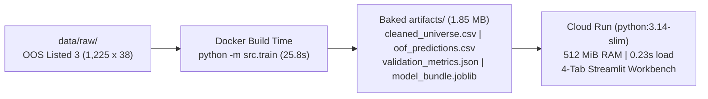

# Corporate Credit Shadow-Rating & Underwriting Workbench

> **Live Demo:** [**https://credit-rating-workbench-371024701820.us-west1.run.app**](https://credit-rating-workbench-371024701820.us-west1.run.app)

An institutional corporate credit shadow-rating, relative-value screening, and live balance-sheet stress-testing workbench built across **1,224 listed Indian corporates (FY25)**. It pairs a transparent 18-notch cumulative ordinal logistic scorecard (exact additive pillar waterfalls) with nonlinear gradient-boosted benchmarks, calibrated Investment-Grade (IG) cliff probabilities, and real-time underwriting shock simulation.

---

## Architecture & Lean Deployment

Training and dual cross-validation run offline during the Docker image build (`python -m src.train`, `25.8s`), baking `1.85 MB` of cleaned tables, strict Out-of-Fold (OOF) shadow ratings, metrics, and fitted models into `artifacts/`. At runtime, the self-contained `python:3.14-slim` Cloud Run container serves the 4-tab Streamlit workbench on **512 MiB RAM** with a **0.23s artifact load time**, 7 core Python packages (`streamlit`, `plotly`, `pandas`, `numpy`, `scikit-learn`, `openpyxl`, `joblib`), and **zero external database or scheduler dependencies**.



**4-Tab Workbench (`main.py` & `src/charts.py`):**
1. **Universe & Credit Ladder** — 18-notch rating distribution, IG/HY sector breakdown, and median financial ladder from `AAA` to `C/D`.
2. **Rating-Gap Screener** — Strict OOF Agency vs. Shadow Notch scatter, filterable Rising Star (`>= +2` notches) and Fallen Angel (`<= -2` notches) watchlists, and CSV export.
3. **Underwriting & Stress-Test Simulator** — Dual mode (1,224 listed corporates or custom private-company inputs), pooled NSE Sector peer percentiles, exact 7-pillar linear scorecard waterfall, and live shock sliders tracking Base → Stressed notch and IG-cliff migration.
4. **Model Validation & Scorecard Audit** — Dual CV comparison table, 7-tier OOF confusion matrix heatmap, IG-vs-HY reliability curves, and averaged 17-cutpoint scorecard feature weights.

---

## Domain Engineering Highlights

- **Negative-Denominator Paradox & Implied Debt Reconstruction (`src/data.py`):**
  Raw financials omit explicit debt balances and contain unbounded ratios when equity or cash flows turn negative (e.g., `Total debt/GCA` down to `-100,687x`, `Operating Cycle` across `±34M` days). Exact positive `implied_total_debt` is recovered via `Overall gearing ratio × Networth` — which remains strictly positive across all **58 negative-Networth distressed firms** because `(-gearing) × (-Networth) > 0` (`0.58%` median discrepancy vs. `Total debt/GCA × GCA`). A deterministic fallback to `Total debt/GCA × GCA` handles **23 edge-case rows** (`|Networth| < 1` or gearing rounding to `0` while `Total debt/GCA > 0`), yielding a realistic **10.56% median implied cost of debt** (`Interest / implied_total_debt`, $n = 1,151$). Unbounded ratios are replaced with negative-denominator-proof solvency/coverage features (`gca_to_debt`, `pbildt_to_debt`, `networth_to_tce`, `asinh(interest_coverage)`) plus explicit distress flags (`is_negative_networth`, `is_negative_gca`, `is_negative_pbildt`).

- **Zero-Leakage Design (`src/features.py` & `src/modeling.py`):**
  Non-annualized statements (`Months != 12`) are quarantined upfront (`KEYSTONE REALTORS LIMITED`, `Months = 0`), leaving **1,224 valid corporates**. All scaling and peer benchmarking live inside a scikit-learn `CreditFeatureTransformer` fitted **strictly inside each CV fold**, pooling tiny sectors (`n < 5`, e.g., `Utilities` and single-firm `Financial Services`) upward through `NSE Sector → NSE Macro Industry → Universe` medians. Every company-level shadow rating and watch flag in the screener comes **100% from Out-of-Fold (OOF)** predictions.

- **Coherent Balance-Sheet Stress Testing (`apply_stress_shocks`):**
  Live underwriting shocks — **Interest Rate (`+bps`)** applied directly to `implied_total_debt`, **PBILDT (`%`)**, **Debt (`%`)**, and **Working Capital Days (`+days`)** — propagate cleanly through `PBILDT`, `PBT`/`PAT`, `GCA`, `ROCE`, interest coverage, and leverage without allowing debt bloat to artificially boost structural scale. Credit-direction sign bounds on the 17 cumulative logistic cutpoints guarantee mathematically monotonic **Base → Stressed** notch and IG-cliff migration across both solvent and distressed entities.

---

## Dual Cross-Validation Results

Evaluated via **5-Fold Stratified CV** (in-universe shadow rating accuracy across all 18 notches) and **5-Fold GroupKFold by NSE Macro Industry** (strict out-of-sector generalization to unseen macro industries):

| Model | CV Scheme | Notch MAE | ±1 Notch % | ±2 Notch % | Broad-Tier Acc | QWK (18-Notch) | IG ROC-AUC | IG PR-AUC | IG Brier |
|---|---|---:|---:|---:|---:|---:|---:|---:|---:|
| **OrdinalLogistic (Primary)** | Stratified 5-Fold | **1.56** | 50.7% | **76.6%** | **60.3%** | **0.799** | **0.909** | 0.978 | 0.0744 |
| **OrdinalLogistic (Primary)** | GroupKFold (Macro) | **1.56** | 50.7% | 76.2% | 60.0% | **0.798** | **0.906** | 0.977 | 0.0749 |
| **HistGradientBoosting** | Stratified 5-Fold | **1.52** | 51.4% | 78.3% | 59.4% | **0.820** | **0.928** | 0.985 | **0.0695** |
| **HistGradientBoosting** | GroupKFold (Macro) | 1.58 | 49.1% | 76.8% | 59.1% | 0.801 | 0.921 | 0.983 | 0.0691 |
| **IG-Cliff Cal. Logistic** | Stratified 5-Fold | — | — | — | — | — | 0.911 | 0.978 | 0.0753 |
| **IG-Cliff Cal. Logistic** | GroupKFold (Macro) | — | — | — | — | — | 0.908 | 0.978 | 0.0761 |

*Key takeaway:* `OrdinalLogistic` matches its in-universe accuracy almost identically out-of-sector (`1.56` MAE / `0.798` QWK vs. `1.56` MAE / `0.799` QWK), outperforming `HistGradientBoosting` (`1.58` MAE) on unseen macro industries while providing exact additive pillar waterfalls for credit-committee auditability.

---

## Real-World Underwriting Findings (OOF Rating-Gap Screener)

Inspecting the largest strict OOF divergences (`Notch Gap = Agency Notch - Shadow Notch`) surfaces three classic institutional credit-rating mechanics:

1. **Parent-Support Notch Uplift:** **Alok Industries Limited** (`AA+` agency vs. `B` standalone shadow, `-12.55` notch gap) — standalone leverage and earnings profile as sub-investment-grade, whereas the agency rating reflects explicit strategic parentage from Reliance Industries.
2. **Post-Default Curing Lag:** **PC Jeweller Limited** (`D` agency vs. `AA-` shadow, `+13.86` notch gap; alongside restructuring cases such as **Reliance Power** and **Rajesh Exports**) — headline equity/scale metrics recover faster than agency ratings due to mandatory post-default curing periods before upgrading out of `D`.
3. **Vendor-Data Anomaly Detection:** **Epack Prefab Technologies Limited** (`A+` vs. `D`, `-12.86` gap) and **Danish Power Limited** (`A-` vs. `D`, `-10.79` gap) — automatically flagged as extreme outliers caused by anomalous raw source-feed figures, intentionally left unedited in `data/raw/` to preserve upstream auditability.

---

## Local Setup, Verification & Repo Structure

```bash
# 1. Create and activate virtual environment
python -m venv .venv
# Windows PowerShell:
.\.venv\Scripts\Activate.ps1
# macOS / Linux:
# source .venv/bin/activate

# 2. Install the 7 core dependencies
pip install -r requirements.txt

# 3. Run offline cleaning, Dual CV, and artifact generation (~26s)
python -m src.train

# 4. Run full verification suite (6/6 tests: quarantine, implied debt, leakage isolation,
#    ordinal monotonicity & additive attributions, stress-test directional sanity, OOF integrity)
python -m unittest tests/verify_pipeline.py -v

# 5. Launch the 4-tab Streamlit workbench locally
streamlit run main.py
```

```text
credit-rating-workbench/
├── data/
│   └── raw/
│       └── Dataoffinancialsindustryrating.xlsx   # Static FY25 NSE corporate snapshot (OOS Listed 3)
├── docs/
│   └── ARCHITECTURE.md                           # Full engineering & modeling specification
├── src/
│   ├── data.py                                   # Cleaning, Months != 12 quarantine, implied debt, target ladder
│   ├── features.py                               # Leakage-free CreditFeatureTransformer & stress propagation
│   ├── modeling.py                               # OrdinalLogistic, HistGradientBoosting, IG-Cliff, Dual CV
│   ├── charts.py                                 # Reusable Plotly charts for all 4 tabs
│   └── train.py                                  # Offline training CLI -> writes artifacts/
├── artifacts/                                    # Generated by src.train (1.85 MB, baked into Docker image)
├── tests/
│   └── verify_pipeline.py                        # 6-suite automated pipeline & monotonicity verifier
├── main.py                                       # 4-tab Streamlit workbench entrypoint
├── Dockerfile                                    # Lean python:3.14-slim Cloud Run image (512 MiB RAM)
├── .gcloudignore                                 # Keeps build context minimal while retaining data/raw/
└── requirements.txt                              # 7 core Python packages only
```

For full mathematical formulations, feature bounds, and verification invariants, see [docs/ARCHITECTURE.md](docs/ARCHITECTURE.md).
