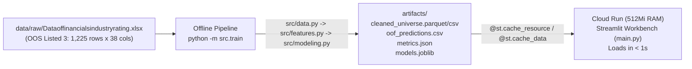

# Corporate Credit Shadow-Rating & Underwriting Workbench — Architecture

## 1. System Overview & Lean Cloud Run Deployment

**Project 3 (`credit-rating-workbench`)** is an institutional corporate credit shadow-rating, relative-value screening, and interactive underwriting stress-test workbench built on a static cross-sectional financial snapshot of listed Indian corporates.

### Data Snapshot Profile (`data/raw/Dataoffinancialsindustryrating.xlsx`, sheet `OOS Listed 3`)
- **Universe:** 1,225 raw rows (38 columns, zero missing cells) → **1,224 valid corporates** after quarantining 1 row with `Months != 12` (`KEYSTONE REALTORS LIMITED`, `Months = 0`).
- **Scope:** 100% `Listed Company`, `Consolidated` financials; reporting periods `31-Mar-2025(Actual)` (1,219 firms) and `31-Dec-2025(Actual)` (5 firms).
- **Taxonomy:** 12 `NSE Macro Industry` groups, 22 `NSE Sector` groups, 52 `NSE Industry` groups, 130 `NSE Basic Industry` groups.
- **Target Distribution (1,224 firms):** 18 ordered credit notches (`AAA = 1` to `D = 18`, minimum notch count `B-` = 8), 7 broad tiers (`AAA` 69, `AA` 338, `A` 350, `BBB` 278, `BB` 80, `B` 38, `C/D` 71), and binary Investment Grade split (`is_ig = 1` for `BBB-` and above: **1,035 IG / 84.56%** vs. **189 HY / 15.44%**).

### Deployment & Runtime Architecture
- **Container:** Self-contained `python:3.14-slim` Docker image deployed on **Google Cloud Run** (`512Mi` RAM, 1 vCPU, port `8080`).
- **Strict Minimal Dependencies (7 packages only):** `streamlit`, `plotly`, `pandas`, `numpy`, `scikit-learn`, `openpyxl`, `joblib`. No BigQuery, Cloud Scheduler, database services, or external boosting libraries (no XGBoost/LightGBM/CatBoost).
- **Offline Build / Fast Online Serve:** All cleaning, feature engineering, dual cross-validation, and model fitting run offline via `python -m src.train`, persisting lightweight serialized outputs to `artifacts/`. At runtime, `main.py` loads precomputed artifacts via `@st.cache_resource` / `@st.cache_data` in **< 1 second** with minimal memory footprint.



### Repository Layout
```text
credit-rating-workbench/
├── data/
│   └── raw/
│       └── Dataoffinancialsindustryrating.xlsx
├── docs/
│   └── ARCHITECTURE.md
├── src/
│   ├── __init__.py
│   ├── data.py          # Ingestion, whitespace hygiene, quarantine, implied debt, target & peer mapping
│   ├── features.py      # Leakage-free sklearn FeatureEngineer transformer & stress-shock propagation
│   ├── modeling.py      # OrdinalLogistic, HistGradientBoosting benchmarks, IG-Cliff models, dual CV
│   ├── charts.py        # Reusable Plotly chart builders (credit ladder, screener, waterfall, audit)
│   └── train.py         # CLI entrypoint: python -m src.train -> populates artifacts/
├── artifacts/           # Generated offline by src.train (bundled into Docker image)
│   ├── cleaned_universe.csv
│   ├── quarantined_rows.csv
│   ├── oof_predictions.csv
│   ├── validation_metrics.json
│   └── model_bundle.joblib
├── tests/
│   └── verify_pipeline.py
├── main.py              # 4-tab Streamlit workbench
├── Dockerfile           # python:3.14-slim self-contained Cloud Run image
└── requirements.txt     # Pinned 7 core packages
```

---

## 2. Data Cleaning & Implied Debt Reconstruction (`src/data.py`)

### 2.1 Schema Hygiene & Quarantine
1. **Whitespace Normalization:** Strip leading/trailing whitespace on all column headers (fixes `'Rating '` → `'Rating'`) and all string columns (fixes trailing spaces in `State` on 184 rows such as `'Gujarat '`, `'Rajasthan '`, `'Assam '`, and leading/trailing spaces in `Period` on all 1,225 rows).
2. **Annualization Guard (`Months != 12` Quarantine):** Partition any record where `Months != 12` into `quarantined_rows.csv` with a reason tag (`"Non-12-month reporting period"`). In the source snapshot, this isolates exactly 1 record:
   - `KEYSTONE REALTORS LIMITED` (Excel row 405, `Months = 0`, `TOI = 0`, `Networth = 0`, `Rating = A+`), yielding **1,224 valid corporates**.

### 2.2 Implied Debt & Borrowing Cost Reconstruction
The raw workbook provides leverage ratios (`Overall gearing ratio`, `Long Term Debt Equity Ratio`, `Total debt/GCA`, `Term debt/GCA`) and balance-sheet/flow anchors (`Networth`, `GCA`, `Interest`), but no explicit debt balance column. Debt is reconstructed deterministically:

1. **`implied_total_debt` (Rs. crore):**
   - **Primary:** `Overall gearing ratio * Networth`
   - **Fallback:** `Total debt/GCA * GCA` whenever `|Networth| < 1.0` (recovers `Konark Synthetic Limited`, `NW = 0.00`, `GCA = -2.10`, `TD/GCA = -14.20` → `29.82 Cr` matching `TCE = 30.30 Cr`) **or** `Overall gearing ratio == 0` while `Total debt/GCA > 0` (recovers 22 low-leverage firms where gearing rounded to `0.00`, e.g., `PARAS DEFENCE AND SPACE TECHNOLOGIES`, `NHC FOODS LIMITED`).
   - **Clip:** `max(0.0, value)`.
   - **Negative-Networth Consistency:** Verified across all 58 negative-Networth firms that `Overall gearing ratio <= 0` in 100% of cases (`0` sign inversions), so `(-gearing) * (-Networth) > 0` accurately recovers total debt (median relative discrepancy vs. `Total debt/GCA * GCA` is **0.58%**; median `(Networth + implied_total_debt) / TCE` is **0.980**).
2. **`implied_term_debt` (Rs. crore):**
   - **Primary:** `Long Term Debt Equity Ratio * Networth`
   - **Fallback:** `Term debt/GCA * GCA` when `|Networth| < 1.0` or `Long Term Debt Equity Ratio == 0` while `Term debt/GCA > 0` (43 rows).
   - **Bound:** Clipped to `[0.0, implied_total_debt]` (resolves 2 minor rounding cases where reconstructed term debt slightly exceeds total debt).
3. **`implied_cost_of_debt`:**
   - Computed as `Interest / implied_total_debt` where `implied_total_debt > 0` ($n = 1,151$; median **10.56%**, IQR **7.72%–15.87%**); set to `NaN` for the 73 zero-debt firms (whose minor `Interest` values reflect lease liabilities or bank charges).

### 2.3 Target Encoding & Rating Ladder

| `notch_num` | Rating | Broad Tier (7) | `is_ig` | Universe Count | Share |
|---:|:---:|:---:|:---:|---:|---:|
| 1 | `AAA` | `AAA` | 1 | 69 | 5.64% |
| 2–4 | `AA+`, `AA`, `AA-` | `AA` | 1 | 95 / 103 / 140 (338) | 27.61% |
| 5–7 | `A+`, `A`, `A-` | `A` | 1 | 110 / 122 / 118 (350) | 28.59% |
| 8–10 | `BBB+`, `BBB`, `BBB-` | `BBB` | 1 | 100 / 89 / 89 (278) | 22.71% |
| 11–13 | `BB+`, `BB`, `BB-` | `BB` | 0 | 43 / 25 / 12 (80) | 6.54% |
| 14–16 | `B+`, `B`, `B-` | `B` | 0 | 10 / 20 / 8 (38) | 3.10% |
| 17–18 | `C`, `D` | `C/D` | 0 | 10 / 61 (71) | 5.80% |

- **IG-Cliff Boundary:** `is_ig = 1` iff `notch_num <= 10` (`BBB-` and above).

### 2.4 Sector Peer Grouping & Tiny-Sector Fallback
Two `NSE Sector` groups have fewer than 5 firms in the 1,224-firm universe:
- `Utilities` ($n = 3$): pooled upward to `NSE Macro Industry = Utilities` ($n = 16$, combined with `Power` $n = 13$).
- `Financial Services` ($n = 1$, `RPSG VENTURES LIMITED`, rating `A-`): both `NSE Sector` and `NSE Macro Industry` have $n = 1 < 5$, so it falls back cleanly to **universe-level peer statistics** (median and robust scale).

The hierarchical peer lookup rule (`MIN_PEER_GROUP_SIZE = 5`) is:
$$\text{Peer Group}(i) = \begin{cases} \text{NSE Sector} & \text{if } n_{\text{train}}(\text{Sector}) \ge 5 \\ \text{NSE Macro Industry} & \text{else if } n_{\text{train}}(\text{Macro}) \ge 5 \\ \text{Universe} & \text{otherwise} \end{cases}$$
This rule guarantees zero `NaN` or zero-variance peer statistics in both Stratified CV and Out-of-Sector `GroupKFold` (where an entire Macro Industry is absent from the training fold and cleanly falls back to Universe statistics).

---

## 3. Leakage-Free Feature Engineering (`src/features.py`)

### 3.1 Architecture: `CreditFeatureTransformer(BaseEstimator, TransformerMixin)`
All feature scaling and peer-group benchmarking statistics (sector/macro/universe medians, robust scales, and `StandardScaler` parameters) are encapsulated inside a single scikit-learn `Pipeline` step fitted **exclusively on the training fold** inside every CV split. No full-dataset quantiles, medians, or scalers are ever computed prior to splitting.

### 3.2 Feature Specification (7 Credit Pillars, 22 Engineered Features)

Audit of raw ratios shows severe near-zero / negative denominator blow-ups (e.g., `PBILDT Margin` down to `-79,408%`, `PAT Margin` up to `+125,676%`, `Total debt/GCA` down to `-100,687x`, `Operating Cycle` from `-34.1M` to `+12.5M` days). The feature set uses deterministic domain clipping, inverted cashflow-to-debt solvency ratios, and signed transforms so every feature is finite, well-scaled, and credit-monotonic:

| Pillar | Feature Name | Deterministic Formula / Domain Bounds | Credit Direction (Stronger = Lower Notch) |
|---|---|---|---|
| **1. Scale** | `log_toi` | $\log(1 + \max(\text{TOI}, 0))$ | Higher = stronger |
| | `signed_log_networth` | $\text{sign}(\text{NW}) \cdot \log(1 + |\text{NW}|)$ | Higher = stronger |
| | `log_tce` | $\log(1 + \max(\text{TCE}, 0))$ | Higher = stronger |
| **2. Profitability** | `pbildt_margin_clip` | $\text{clip}(\text{PBILDT Margin \%}, -50, 75)$ | Higher = stronger |
| | `pat_margin_clip` | $\text{clip}(\text{PAT Margin \%}, -50, 50)$ | Higher = stronger |
| | `roce_clip` | $\text{clip}(\text{ROCE \%}, -40, 80)$ | Higher = stronger |
| **3. Solvency & Coverage** *(negative-denom proof)* | `gca_to_debt` | $\text{clip}\!\left(\frac{\text{GCA}}{\max(\text{implied\_total\_debt},\, 1.0)},\, -2.0,\, 5.0\right)$ | Higher = stronger |
| | `pbildt_to_debt` | $\text{clip}\!\left(\frac{\text{PBILDT}}{\max(\text{implied\_total\_debt},\, 1.0)},\, -2.0,\, 5.0\right)$ | Higher = stronger |
| | `networth_to_tce` | If $\text{TCE} > 1$: $\text{clip}(\text{NW}/\text{TCE}, -1.0, 1.2)$; else if $\text{NW} < 0$: $-1.0$; else $0.0$ | Higher = stronger |
| | `asinh_interest_coverage` | $\operatorname{asinh}(\text{clip}(\text{Interest coverage}, -50, 500))$ | Higher = stronger |
| | `short_term_debt_share` | $\text{clip}\!\left(\frac{\text{implied\_total\_debt} - \text{implied\_term\_debt}}{\text{implied\_total\_debt}}, 0, 1\right)$ if debt $> 0$, else $0.0$ | Lower = stronger (refinancing risk) |
| **4. Distress Flags** | `is_negative_networth` | $\mathbb{I}(\text{Networth} < 0)$ (58 firms) | `1` = weaker |
| | `is_negative_gca` | $\mathbb{I}(\text{GCA} < 0)$ (87 firms) | `1` = weaker |
| | `is_negative_pbildt` | $\mathbb{I}(\text{PBILDT} < 0)$ (89 firms) | `1` = weaker |
| **5. Liquidity & Working Capital** | `current_ratio_clip` | $\text{clip}(\text{Current ratio}, 0, 10)$ | Higher = stronger |
| | `quick_ratio_clip` | $\text{clip}(\text{Quick ratio}, 0, 8)$ | Higher = stronger |
| | `op_cycle_clip` | $\text{clip}(\text{Operating Cycle (days)}, -180, 730)$ | Lower = stronger |
| **6. Growth** | `income_growth_clip` | $\text{clip}(\text{Growth in Total Income \%}, -100, 200)$ | Higher = stronger |
| | `pat_growth_clip` | $\text{clip}(\text{Growth in PAT \%}, -100, 200)$ | Higher = stronger |
| **7. Sector-Relative Z-Scores** *(fold-fitted)* | `rel_pbildt_margin_z` | $\text{clip}\!\left(\frac{\text{pbildt\_margin\_clip} - m_{\text{peer}}}{s_{\text{peer}}},\, -4, 4\right)$ | Higher = stronger |
| | `rel_roce_z` | $\text{clip}\!\left(\frac{\text{roce\_clip} - m_{\text{peer}}}{s_{\text{peer}}},\, -4, 4\right)$ | Higher = stronger |
| | `rel_leverage_z` | $\text{clip}\!\left(\frac{\text{pbildt\_to\_debt} - m_{\text{peer}}}{s_{\text{peer}}},\, -4, 4\right)$ | Higher = stronger |

- **Fold-Fitted Peer Scale ($m_{\text{peer}}, s_{\text{peer}}$):** Computed on `X_train` only using the Section 2.4 peer hierarchy (`NSE Sector` if $n \ge 5$ → `NSE Macro Industry` if $n \ge 5$ → `Universe`), where $m_{\text{peer}}$ is the training-fold median and $s_{\text{peer}} = \max(1.4826 \times \text{MAD}_{\text{peer}},\, \text{IQR}_{\text{peer}}/1.349,\, \epsilon)$ prevents division by zero.
- **Standardization:** For linear/ordinal models, continuous features are `StandardScaler`-transformed (fitted on `X_train`); binary distress flags remain unscaled `{0, 1}` (or are standardized consistently inside the pipeline so coefficients remain directly comparable). For `HistGradientBoosting*`, the identical leakage-free `CreditFeatureTransformer` feeds raw domain-clipped + fold-relative features (scaling is invariant for trees).

### 3.3 Stress-Test Shock Propagation Function (`apply_stress_shocks`)
To ensure real-time shocks in Tab 3 remain financially self-consistent and directionally sound:
- **Inputs:** Base company financial record + 4 user shock parameters:
  1. `rate_shock_bps` ($\ge 0$, e.g. `0` to `+500` bps)
  2. `pbildt_shock_pct` ($\le 0$, e.g. `-60%` to `0%`)
  3. `debt_shock_pct` ($\ge 0$, e.g. `0%` to `+100%`)
  4. `wc_days_shock` (e.g. `0` to `+120` days)
- **Propagation Equations:**
  - $\text{Debt}' = \text{implied\_total\_debt} \times (1 + \text{debt\_shock\_pct}/100)$, $\Delta \text{Debt} = \text{Debt}' - \text{implied\_total\_debt}$.
  - $\text{CostOfDebt}_{\text{eff}} = \text{clip}(\text{implied\_cost\_of\_debt},\, 0.06,\, 0.18)$ (defaulting to universe median `0.105` if debt-free).
  - $\text{Interest}' = \text{Interest} + \text{Debt}' \cdot \frac{\text{rate\_shock\_bps}}{10000} + \Delta \text{Debt} \cdot \text{CostOfDebt}_{\text{eff}}$.
  - $\text{PBILDT}' = \text{PBILDT} - |\text{PBILDT}| \cdot |\text{pbildt\_shock\_pct}|/100$ (so negative-PBILDT firms worsen rather than improve under a negative shock), with $\Delta \text{PBILDT} = \text{PBILDT}' - \text{PBILDT} \le 0$.
  - $\text{PBILDT Margin}' = \text{PBILDT Margin} + \frac{\Delta \text{PBILDT}}{\max(\text{TOI}, 1.0)} \times 100$.
  - $\text{GCA}' = \text{GCA} + \Delta \text{PBILDT} - (\text{Interest}' - \text{Interest})$ (pre-tax conservative cashflow pass-through; PAT and PAT Margin shift identically).
  - $\text{TCE}' = \text{TCE} + \Delta \text{Debt}$; $\text{ROCE}'$ scales down with $\text{PBILDT}'$ and $\text{TCE}'$ (`EBIT' / TCE'` when `TCE' > 1`).
  - $\text{Interest coverage}' = \text{PBILDT}' / \max(\text{Interest}', 0.1)$ (capped never to exceed base coverage under adverse shocks).
  - $\text{Operating Cycle}' = \text{Operating Cycle} + \text{wc\_days\_shock}$; `Current ratio` / `Quick ratio` remain unchanged or adjust conservatively if WC shock is funded via short-term debt.
- The stressed record is passed through the **frozen full-fit `CreditFeatureTransformer`** and scored immediately by `OrdinalLogistic` and the calibrated IG-Cliff model.

---

## 4. Ordinal & Binary Modeling + Dual Cross-Validation (`src/modeling.py`)

### 4.1 Primary Model: `OrdinalLogistic` (Cumulative Binary Decomposition)
Standard regression ignores ordinal probability bounds, while multinomial classification discards notch ordering. `OrdinalLogistic` implements Frank & Hall (2001) cumulative ordinal classification over notches $k \in \{1, \dots, 18\}$:

1. **17 Cumulative Classifiers:** Fit 17 L2-regularized `LogisticRegression(C=..., solver="lbfgs", max_iter=1000)` binary models for thresholds $t \in \{2, \dots, 18\}$, each predicting $q_t(x) = P(Y \ge t \mid x)$.
2. **Monotonic Probability Projection:** Because independently fitted binary classifiers can occasionally cross ($q_{t+1} > q_t$), enforce monotonicity via cumulative minimum (or Pool-Adjacent-Violators isotonic projection):
   $$\tilde{q}_1 = 1, \quad \tilde{q}_t = \min(\tilde{q}_{t-1},\, \text{clip}(q_t, 0, 1)) \text{ for } t=2\dots 18, \quad \tilde{q}_{19} = 0$$
   Individual notch probabilities are $p_k = \tilde{q}_k - \tilde{q}_{k+1}$ ($k = 1 \dots 18$), guaranteeing $p_k \ge 0$ and $\sum_{k=1}^{18} p_k = 1$ identically.
3. **Point & Tier Outputs:**
   - **Expected Continuous Notch:** $\hat{y}(x) = \sum_{k=1}^{18} k \cdot p_k = 1 + \sum_{t=2}^{18} \tilde{q}_t(x) \in [1, 18]$.
   - **Predicted Discrete Notch:** $\text{round}(\hat{y}(x))$ clipped to $[1, 18]$ → mapped to rating string and 7 broad tiers.
   - **Broad-Tier Probabilities:** Sum $p_k$ over notches belonging to each of the 7 tiers.
4. **Exact Linear Pillar Attributions (Credit-Scorecard Transparency):**
   - For each threshold $t$, the linear predictor is $\eta_t(x) = \beta_{0,t} + \sum_{j=1}^{d} \beta_{j,t} z_j$.
   - Using the local sensitivity (first-order exact Taylor / Integrated Gradients along the linear path from universe mean $z = 0$ to $z(x)$, evaluated with 20-point Gauss-Legendre / midpoint quadrature over $\alpha \in [0, 1]$), the exact additive contribution of feature $j$ to the expected notch shift $\hat{y}(z) - \hat{y}(0)$ is:
     $$\phi_j(x) = z_j \int_0^1 \left(\sum_{t=2}^{18} \tilde{q}_t(\alpha z)\bigl(1 - \tilde{q}_t(\alpha z)\bigr)\beta_{j,t}\right) d\alpha, \qquad \hat{y}(0) + \sum_{j=1}^{d} \phi_j(x) = \hat{y}(x)$$
   - Summing $\phi_j(x)$ across each of the 7 pillars produces an **exact, additive waterfall decomposition** from the universe baseline notch $\hat{y}(0)$ to the company's predicted shadow notch $\hat{y}(x)$ (zero approximation error and no black-box SHAP dependency).
   - For global scorecard auditing (Tab 4), we also report the mean threshold weight $\bar{\beta}_j = \frac{1}{17}\sum_{t=2}^{18} \beta_{j,t}$ across all 17 cutpoints (with sign check confirming directional credit intuition).
   - *Stress-Test Monotonicity Note:* During `src.train`, we verify global feature-weight signs and stress-test monotonicity across the universe; if any correlated collinear feature (e.g., `pat_margin_clip` vs. `pbildt_margin_clip`) exhibits sign reversal under heavy collinearity, L2 regularization strength $C$ is tuned inside CV to preserve both OOF MAE and directional scorecard stability.

### 4.2 Nonlinear Benchmarks & IG-Cliff Models
1. **Nonlinear Notch & Tier Benchmarks:**
   - `HistGradientBoostingRegressor` (scikit-learn native, `max_depth=4`, `min_samples_leaf=20`, `l2_regularization=1.0`, `monotonic_cst` where applicable) predicting continuous `notch_num` (clipped `[1, 18]`).
   - `HistGradientBoostingClassifier` predicting the **7 broad tiers** directly (`AAA` through `C/D`).
2. **IG-Cliff Binary Models (`is_ig`, `BBB-` and above):**
   - **Primary Interpretable IG-Cliff:** `CalibratedClassifierCV(LogisticRegression(C=...), method="sigmoid", cv=5)` predicting calibrated $P(\text{IG})$.
   - **Nonlinear IG-Cliff Benchmark:** `CalibratedClassifierCV(HistGradientBoostingClassifier(...), method="sigmoid", cv=5)`.
   - Also cross-checked against `OrdinalLogistic`'s implied $P(\text{IG}) = \sum_{k=1}^{10} p_k = 1 - \tilde{q}_{11}$ to verify internal coherence between the ordinal ladder and the binary cliff model.

### 4.3 Dual Cross-Validation & Rating-Gap Sign Convention
- **CV Scheme A — Stratified 5-Fold CV (`StratifiedKFold(n_splits=5, shuffle=True, random_state=42)`):**
  - Stratified on exact 18-notch `notch_num` (valid because smallest class `B-` has $n = 8 \ge 5$).
  - **Strict OOF Rule:** Every company-level shadow rating (`shadow_notch`, `shadow_rating`, `shadow_tier`, `p_ig`) displayed in Tab 2 and Tab 4 comes **strictly from Out-of-Fold predictions** — no company is ever evaluated using a model that saw it during training.
  - Final production models for Tab 3 live underwriting / stress-testing are refitted on all 1,224 rows after CV validation completes.
- **CV Scheme B — Out-of-Sector CV (`GroupKFold(n_splits=5)` on `NSE Macro Industry`):**
  - Holds out entire NSE Macro Industries in each fold to measure structural generalization to unseen sectors (where `CreditFeatureTransformer` exercises its Macro → Universe median fallback).
- **Rating-Gap Sign Convention (explicitly defined to avoid sign ambiguity):**
  - Since `AAA = 1` (strongest) and `D = 18` (weakest):
    - Raw notch difference: `raw_notch_diff = shadow_notch - agency_notch` (negative = shadow rating is stronger than agency rating; positive = shadow rating is weaker).
    - **Credit Gap (`rating_gap_notches`):** `agency_notch - shadow_notch` (`= -(shadow_notch - agency_notch)`):
      - **Rising Star (Upgrade Watch):** `rating_gap_notches >= +2.0` (i.e., `shadow_notch - agency_notch <= -2.0` — fundamentals look ≥ 2 notches **stronger** than current agency rating).
      - **Fallen Angel (Downgrade Watch):** `rating_gap_notches <= -2.0` (i.e., `shadow_notch - agency_notch >= +2.0` — fundamentals look ≥ 2 notches **weaker** than current agency rating).
      - **In-Line:** `-2.0 < rating_gap_notches < +2.0`.

### 4.4 Validation Metrics Suite (Saved to `artifacts/validation_metrics.json`)
Computed identically for both Stratified 5-Fold OOF and Out-of-Sector GroupKFold OOF across all models:
- **Ordinal / Regression Metrics:** Notch MAE, Within ±1 Notch %, Within ±2 Notch %, Broad-Tier Accuracy (7 tiers), Quadratic Weighted Kappa (QWK, on both 18 notches and 7 broad tiers).
- **IG-vs-HY Binary Metrics:** ROC-AUC, PR-AUC (Average Precision, reported for both IG and HY minority class), and Brier Score.

---

## 5. 4-Tab Streamlit Workbench (`main.py` & `src/charts.py`)

The application loads precomputed artifacts (`cleaned_universe.csv`, `oof_predictions.csv`, `validation_metrics.json`, `model_bundle.joblib`) once at startup (`< 1s`, `< 150Mi` resident RAM) and renders four institutional tabs:

| Tab | Title | Key Visuals & Interactive Components |
|---|---|---|
| **Tab 1** | **Universe & Credit Ladder** | Top KPI strip (1,224 corporates, IG %, median TOI, quarantined count); 18-notch / 7-tier rating distribution bar chart; `NSE Macro Industry` & `NSE Sector` stacked IG/HY breakdown; **Credit Ladder Table & Multi-Metric Chart** showing median financial ratios (`TOI`, `PBILDT Margin`, `ROCE`, `GCA/Debt`, `Interest Coverage`, `Operating Cycle`, `Implied Debt`) stepping monotonically from `AAA` down to `C/D`. |
| **Tab 2** | **Rating-Gap Screener** | Strict OOF **Agency Notch vs. Shadow Notch** interactive Plotly scatter plot (with ±2 notch corridor bands, hover cards showing financials & `P(IG)`, color-coded by Watch status); sidebar/inline filters (`NSE Macro Industry`, `NSE Sector`, Agency Tier, IG-Cliff Watch); dedicated filterable **Rising Star (≥ +2 notch upgrade watch)** and **Fallen Angel (≤ -2 notch downgrade watch)** tables; one-click **CSV Export** (`st.download_button`). |
| **Tab 3** | **Underwriting & Stress-Test Simulator** | **Dual Input Mode:** (a) Select any of the 1,224 listed corporates (auto-populating actual financials + reconstructed debt), OR (b) Enter custom private-company financials + NSE Sector. Displays: (1) **Peer Percentile Chart** vs. pooled NSE Sector peers; (2) **Linear Scorecard Notch Driver Waterfall** (exact additive `OrdinalLogistic` pillar attributions from baseline notch to company shadow notch); (3) **Live Stress-Test Shock Sliders** — Interest Rate (`0` to `+500 bps` applied to `implied_total_debt`), PBILDT Shock (`0%` to `-60%`), Debt Shock (`0%` to `+100%`), Working Capital Days (`0` to `+120 days`) — showing real-time **Base → Stressed** expected notch migration, broad-tier shift, stressed waterfall delta, and **IG-Cliff Risk** gauge ($P(\text{IG})_{\text{base}} \to P(\text{IG})_{\text{stressed}}$). |
| **Tab 4** | **Model Validation & Scorecard Audit** | **Stratified 5-Fold CV vs. Out-of-Sector GroupKFold** comparison table across `OrdinalLogistic`, `HistGradientBoosting`, and calibrated IG-Cliff models (Notch MAE, ±1/±2 Notch %, Broad-Tier Acc, QWK, IG ROC-AUC/PR-AUC/Brier); **7-Tier OOF Confusion Matrix Heatmap**; **IG-vs-HY Calibration / Reliability Curve**; **Scorecard Feature Weights & Pillar Audit** horizontal bar chart showing mean cumulative log-odds coefficients across the 17 thresholds. |

---

## 6. Verification Plan (`tests/verify_pipeline.py`)

Automated pytest/unittest verification script executed after offline training and before deployment, asserting five core invariants:

1. **Data Hygiene & `Months != 12` Quarantine:**
   - Raw Excel sheet loads 1,225 rows; `'Rating '` header and string columns (`State`, `Period`) have zero leading/trailing whitespace after cleaning.
   - Exactly 1 row (`KEYSTONE REALTORS LIMITED`, `Months = 0`) is quarantined; cleaned universe has exactly 1,224 rows with `Months == 12` and all 18 expected rating labels mapped cleanly.
   - Tiny sectors (`Utilities`, `Financial Services`) resolve through the `Sector -> Macro -> Universe` peer hierarchy with zero `NaN`s.
2. **Negative-Networth & Edge-Case Implied Debt Recovery:**
   - All 58 negative-Networth firms reconstruct strictly non-negative `implied_total_debt` matching `(-gearing) * (-Networth) > 0` (spot-checking e.g. `Parsvnath Developers Limited` and `Shree Renuka Sugars Limited`).
   - Fallback recovers positive debt on `|Networth| < 1` (`Konark Synthetic Limited` ≈ `29.82 Cr`) and on `gearing == 0 & Total debt/GCA > 0` firms (`PARAS DEFENCE`, `NHC FOODS`).
   - `0 <= implied_term_debt <= implied_total_debt` and `0 <= short_term_debt_share <= 1` hold for all 1,224 rows.
3. **Fold-Level Leakage Isolation:**
   - Fit `CreditFeatureTransformer` on a training fold `X_train`; assert that massively perturbing features in `X_val` produces **zero change** in the transformer's fitted peer medians, peer scales, `StandardScaler` means/stds, or transformed `X_train` values.
   - Verify OOF predictions in `artifacts/oof_predictions.csv` cover all 1,224 firms exactly once with no `NaN`s.
4. **Ordinal Probability Monotonicity & Additive Attribution Exactness:**
   - For every firm (and synthetic stress scenarios), verify $1 \ge \tilde{q}_2 \ge \dots \ge \tilde{q}_{18} \ge 0$, $p_k \ge 0$, $\left|\sum_{k=1}^{18} p_k - 1\right| < 10^{-9}$, and $\hat{y} \in [1, 18]$.
   - Verify linear scorecard pillar attributions satisfy $\left|\hat{y}(0) + \sum_{p=1}^{7} \phi_{\text{pillar},p}(x) - \hat{y}(x)\right| < 10^{-3}$.
5. **Stress-Test Directional Sanity:**
   - Across a representative sample of solvent & leveraged corporates across tiers (`AAA` through `BB`), assert that applying adverse shocks — higher interest rate (`+300 bps`), negative PBILDT (`-30%`), or higher debt (`+50%`) — strictly worsens or holds the expected notch score ($\hat{y}_{\text{stressed}} \ge \hat{y}_{\text{base}} - 10^{-6}$) and reduces or holds $P(\text{IG})$ ($P(\text{IG})_{\text{stressed}} \le P(\text{IG})_{\text{base}} + 10^{-6}$).
